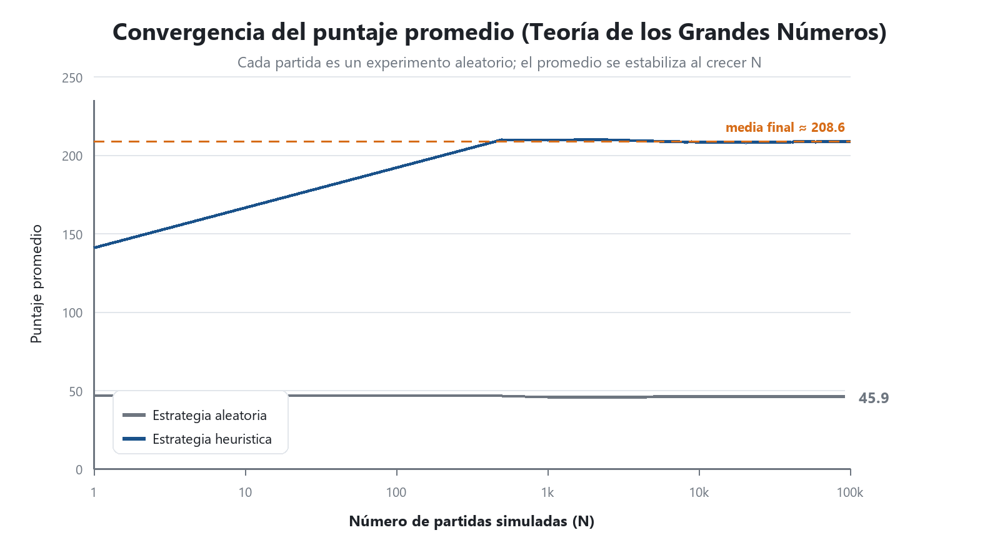

# 🎲 Yahtzee Montecarlo

**Simulación del juego de Yahtzee con dos jugadores y verificación empírica de la Teoría de los Grandes Números mediante el método de Montecarlo.**

Actividad didáctica 2 — Módulo 1 · Asignatura **Simulación** · Juan Camilo Ríos Hernández

---

## 📖 Descripción

Este repositorio contiene un simulador completo del **Yahtzee clásico** para dos jugadores y un
**motor de simulación de Montecarlo** que juega decenas de miles de partidas automáticamente para
estimar el comportamiento del juego.

El programa no se limita a "jugar": está diseñado como un **experimento estadístico**. Cada partida
es una realización de un experimento aleatorio, y al repetirlo miles de veces se observa cómo el
promedio se estabiliza, cómo el error de la estimación disminuye con el número de simulaciones y
cómo las frecuencias observadas se acercan a las probabilidades teóricas.

En otras palabras: el juego es el laboratorio; **Montecarlo y la Ley de los Grandes Números son el
objeto de estudio**.

---

## ✨ Características

| Característica | Descripción |
|---|---|
| 🎯 **Juego completo** | 13 casillas, dos zonas, bono de 35 puntos y hasta 3 lanzamientos por turno |
| 👥 **Dos jugadores** | Modo humano vs humano, humano vs IA e IA vs IA |
| 🤖 **Estrategia heurística** | Árbol de decisión explicable que decide qué dados conservar y dónde anotar |
| 🎲 **Estrategia aleatoria** | Grupo de control para medir cuánto aporta la toma de decisiones |
| 📈 **Motor de Montecarlo** | N partidas configurables con semilla reproducible e intervalos de confianza |
| 🔬 **Experimentos incluidos** | Uniformidad de los dados, convergencia, precisión, dos jugadores y puntaje por casilla |
| 📊 **Gráficas automáticas** | 7 figuras generadas con Pillow, sin depender de matplotlib |
| 🧪 **29 pruebas unitarias** | Reglas, tabla, turnos, reproducibilidad y estadística |
| 📄 **Documento automático** | El informe Word se genera a partir de los datos de la última corrida |

---

## 📊 Resultados principales

Experimento ejecutado con **100.000 partidas por estrategia**, semilla `20262026`, en 159 segundos.

| Métrica | Estrategia heurística | Estrategia aleatoria |
|---|---|---|
| Puntaje medio por partida | **208,56** | 45,88 |
| Desviación estándar | 38,24 | 18,24 |
| Error estándar | 0,121 | 0,058 |
| Intervalo de confianza (95 %) | [208,32 ; 208,80] | [45,77 ; 46,00] |
| Puntaje mínimo / máximo | 87 / 340 | 5 / 160 |

### Evidencias de la Ley de los Grandes Números

| Fenómeno | N = 100 | N = 100.000 | Teoría |
|---|---|---|---|
| Desviación máxima de la frecuencia de cada cara respecto de 1/6 | 0,0427 | **0,0012** | → 0 |
| Error estándar del puntaje medio | 3,665 | **0,121** | ∝ 1/√N |
| Tasa de victorias en juego simétrico | — | **0,484** | 0,496 (descontando empates) |

Al multiplicar por 1.000 el tamaño de la muestra, el error se redujo **30,3 veces**, muy cerca del
factor teórico √1.000 ≈ 31,6.



> Más figuras en la carpeta [`resultados/`](resultados/).

---

## 🗂️ Estructura del repositorio

```
yahtzee-montecarlo/
├── main.py                      # Menú interactivo y línea de comandos
├── src/yahtzee/                 # Paquete con la lógica del juego
│   ├── dados.py                 # Dados, tiradas y conteo de caras
│   ├── puntuacion.py            # Reglas puras de las 13 casillas
│   ├── tabla.py                 # Tabla de puntaje, bono y total
│   ├── estrategias.py           # Aleatoria, heurística y manual
│   ├── juego.py                 # Turnos y partidas
│   ├── montecarlo.py            # Experimentos, estadística y exportación
│   ├── graficas.py              # Figuras del informe (Pillow)
│   └── consola.py               # Entrada y salida por terminal
├── scripts/
│   ├── ejecutar_experimentos.py # Corre todo y genera CSV + JSON + PNG
│   └── resumen_resultados.py    # Imprime un resumen legible
├── tests/                       # 29 pruebas unitarias (unittest)
├── resultados/                  # CSV, JSON y figuras (generados)
├── requirements.txt
└── README.md
```

---

## ⚙️ Requisitos

- **Python 3.10 o superior** (probado con 3.12)
- `Pillow` para generar las gráficas
- `python-docx` solo si se desea regenerar el informe Word

El **núcleo del juego y del motor de Montecarlo no tiene dependencias externas**: funciona con la
biblioteca estándar de Python.

```bash
pip install -r requirements.txt
```

---

## 🚀 Uso

### Menú interactivo

```bash
python main.py
```

```
   1) Jugar 2 jugadores (humanos)
   2) Jugar contra la IA
   3) Ver una partida IA vs IA narrada
   4) Simulación Montecarlo (N partidas)
   5) Experimentos completos + gráficas
   6) Ver reglas del juego
   0) Salir
```

### Línea de comandos

```bash
python main.py jugar                    # dos jugadores humanos
python main.py jugar --contra-ia        # humano contra la estrategia heurística
python main.py jugar --auto             # partida IA vs IA narrada
python main.py simular --n 10000        # Montecarlo con 10.000 partidas
python main.py simular --n 50000 --estrategia aleatoria
python main.py experimentos --n-max 100000
python main.py reglas
```

### Reproducir todos los experimentos

```bash
python scripts/ejecutar_experimentos.py
python scripts/resumen_resultados.py
```

Genera en `resultados/`:

| Archivo | Contenido |
|---|---|
| `convergencia.csv` | Media, desviación e IC por nivel de N |
| `uniformidad_dados.csv` | Frecuencia de cada cara y chi-cuadrado |
| `puntaje_por_casilla.csv` | Puntaje promedio y frecuencia de ceros por casilla |
| `distribucion_puntajes.csv` | Histograma del puntaje por partida |
| `resumen_experimentos.json` | Todos los resultados de la corrida |
| `fig01…fig07 .png` | Figuras del informe |

---

## 🎯 Reglas implementadas

| Zona | Casilla | Puntaje |
|---|---|---|
| Superior | Unos, Dos, Tres, Cuatro, Cinco, Seises | Suma de los dados de esa cara |
| Bono | Bono superior | +35 puntos si la zona superior suma ≥ 63 |
| Inferior | Tres iguales | Suma de los 5 dados (≥ 3 iguales) |
| Inferior | Cuatro de la misma clase | Suma de los 5 dados (≥ 4 iguales) |
| Inferior | Casa llena | 25 puntos |
| Inferior | Pequeño recto | 30 puntos |
| Inferior | Grande y recto | 40 puntos |
| Inferior | Oportunidad | Suma de los 5 dados |
| Inferior | Yahtzee | 50 puntos |

---

## 🪜 Metodología USA · MODIFICA · CREA

### USA — punto de partida
Se estudió el reglamento y el tablero de referencia y se reprodujo casilla por casilla, respetando
nombres y puntajes. En el material de la actividad no se suministró un código base ejecutable, por lo
que esta fase se apoyó en el reglamento y en el tablero de referencia.

### MODIFICA — mejoras sobre la base
- Bono de 35 puntos de la zona superior.
- Validación de jugadas y de casillas ya ocupadas.
- Estrategia heurística para jugar sin intervención humana.
- Estrategia aleatoria como grupo de control.
- Semilla configurable y resultados reproducibles.
- Separación entre reglas, motor, interfaz y estadística.

### CREA — aportes propios
- Motor de Montecarlo con niveles de N sobre una misma muestra.
- Intervalos de confianza al 95 %.
- Prueba chi-cuadrado de uniformidad.
- Experimento de dos jugadores simétrico.
- Generador de gráficas sin dependencias externas (Pillow).
- Exportación a CSV y JSON para auditar los resultados.
- Generación automática del documento técnico.
- 29 pruebas unitarias.

---

## 🏗️ Arquitectura

```
main.py  (interfaz de usuario)
   │
   ├── juego.py ──► estrategias.py ──► tabla.py ──► puntuacion.py ──► dados.py
   │     (turnos)      (decisiones)      (estado)       (reglas)       (azar)
   │
   └── montecarlo.py ──► juego.py
            │
            └── graficas.py  (figuras PNG)
                     ▲
            resultados/ (CSV + JSON)
```

Las dependencias son unidireccionales: las reglas no conocen la interfaz, la interfaz no conoce la
estadística y el motor de simulación reutiliza las reglas sin modificarlas.

---

## 🧪 Pruebas

```bash
python -m unittest discover -s tests -v
```

29 pruebas que cubren puntuación, combinaciones, bono, tabla, validez de las tiradas,
reproducibilidad, número de turnos y estadística.

---

## 🔬 Experimentos

| Experimento | Pregunta que responde | N |
|---|---|---|
| Uniformidad | ¿Los dados son equilibrados? | 100.000 tiradas |
| Convergencia | ¿Se estabiliza el puntaje promedio? | 100 → 100.000 partidas |
| Precisión | ¿Cómo disminuye el error con N? | 100 → 100.000 partidas |
| Distribución | ¿Qué forma tiene el puntaje? | 100.000 partidas |
| Dos jugadores | ¿Es justo el juego simétrico? | 5.000 partidas |
| Por casilla | ¿Dónde se ganan los puntos? | 5.000 partidas |

Todos los resultados son **reproducibles**: con la misma semilla se obtienen exactamente los mismos
números.


---

## 👤 Autor

**Juan Camilo Ríos Hernández**
Asignatura: Simulación · Actividad didáctica 2 — Módulo 1
Fecha: octubre de 2026

---

## 📚 Referencias

- Kolmogórov, A. N. (1933). *Grundbegriffe der Wahrscheinlichkeitsrechnung*. Springer.
- Law, A. M. (2015). *Simulation modeling and analysis* (5.ª ed.). McGraw-Hill.
- Metropolis, N., & Ulam, S. (1949). The Monte Carlo method. *JASA*, 44(247), 335–341.
- Ross, S. M. (2019). *Introduction to probability models* (12.ª ed.). Academic Press.
- Solitaired. (s. f.). *Yahtzee — Juego de dados en línea*. https://solitaired.com/yahtzee
- Python Software Foundation. (2024). *random — Generate pseudo-random numbers*. https://docs.python.org/3/library/random.html
- Clark, A. (2015). *Pillow (PIL Fork) documentation*. https://pillow.readthedocs.io/

---

## 📄 Licencia

MIT. Ver [LICENSE](LICENSE).
